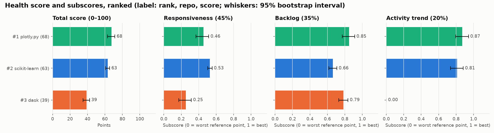
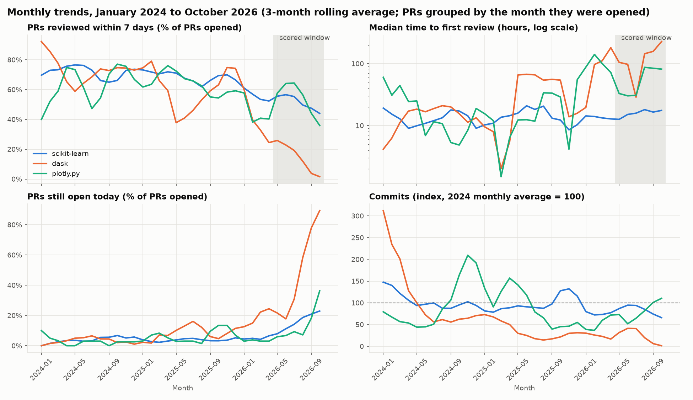
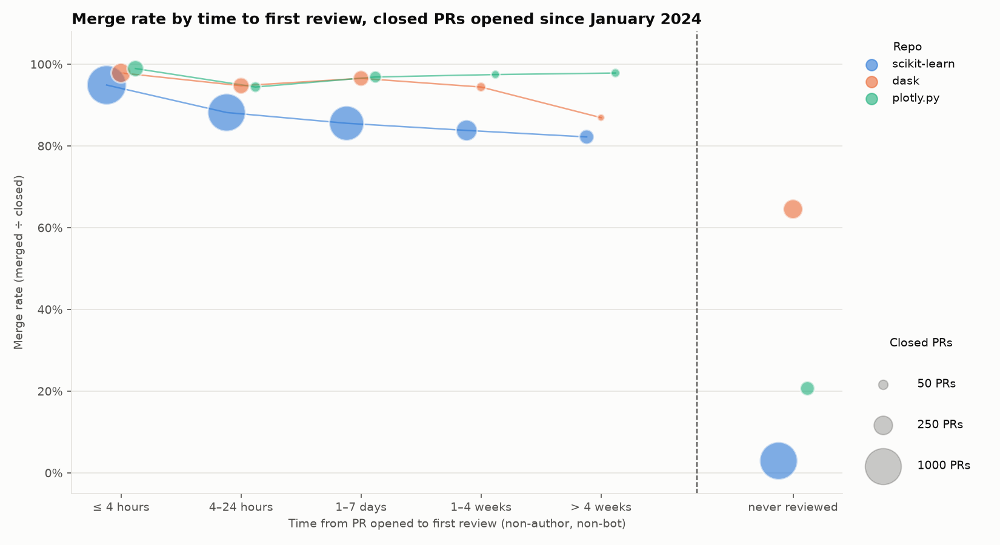

# oss-health-pipeline

How healthy is an open-source project's maintainer community? This pipeline pulls GitHub activity since January 2024 for **scikit-learn**, **dask** and **plotly.py**, and scores each project on how well its maintainers keep up with the people sending them work.

**Stack:** Prefect · GitHub REST + GraphQL APIs · DuckDB · dbt · pandas · matplotlib

One Prefect flow runs six steps:

1. **Extract**: incremental, resumable pulls of commits, PRs, reviews and releases into JSON files, with rate-limit handling
2. **Load**: idempotent upserts into raw DuckDB tables, plus a watermark table for the next run
3. **dbt**: staging, fact and mart models with 36 tests
4. **Validate**: completeness checks, outlier detection and descriptive stats in Python
5. **Score**: a weighted health score with bootstrap confidence intervals and weight sensitivity
6. **Plot**: three figures summarizing the results

## Result

| Rank | Repo | Score | 95% interval |
| --- | --- | --- | --- |
| 1 | plotly.py | 67.6 | 62.8 to 71.4 |
| 2 | scikit-learn | 63.2 | 60.9 to 65.4 |
| 3 | dask | 38.9 | 34.8 to 42.4 |



dask comes last in every bootstrap resample and under every weighting I tried. Its review rate collapsed in 2026, and its commits have stopped. plotly.py and scikit-learn are close, and which one comes first depends on how much you weight backlog against review speed. The data runs through October 2026. Details are in [Health score](#health-score).

## Setup

```
git clone https://github.com/lhakso/oss-health-pipeline.git
cd oss-health-pipeline
uv sync
echo "GH_PAT=<your token>" > .env
```

The token is only read from the `GH_PAT` environment variable, and `.env` is gitignored. The flow logs to whatever Prefect server your profile points to. If none is configured, Prefect starts a temporary local one.

## Running

```
uv run --env-file .env main.py
```

A full run from an empty database took 7 minutes 10 seconds on a Kubernetes work pool (extract 257 s, load 151 s, everything else about 20 s). An incremental run takes 14 seconds. The flow logs each step's time and the total in `logs/package_health_flow.log`.

A run writes `data/raw/` (JSON pages), `packages.duckdb`, one log file per step in `logs/` (plus dbt's own `logs/dbt.log`) and the PNGs in `plots/`.

### Scheduled deployment

`uv run --env-file .env main.py deploy` registers the flow with a Prefect server. A worker clones this repo and runs it at midnight Eastern on the 28th of each month. Deployed runs read the GitHub token from a Prefect Secret block instead of `.env`. You can set the block name, work pool and repo URL with the `PAT_BLOCK`, `WORK_POOL` and `GIT_URL` environment variables.

## Extract

Commits use `since`. PRs and reviews come from GraphQL, newest updated first, and paging stops once it passes the watermark. Releases are fetched in full every time because there are only a couple of pages. Every page is written to a `.tmp` file and renamed when complete, so a crash mid-write never leaves a half page that looks finished. A page that fails to parse gets refetched.

Rate limits are handled in `get_and_check_quota` and `post_graphql` in [pipeline/extract.py](pipeline/extract.py). They read `X-RateLimit-Remaining` and `X-RateLimit-Reset` on every response and sleep until the reset when fewer than 20 requests are left. They also wait out `Retry-After` and secondary limits. 5xx errors raise, and Prefect retries the task after 30, 60 and then 120 seconds.

### Resuming an interrupted run

I hit Ctrl-C on a full run after 24 pages of scikit-learn commits, then started it again.

```
14:18:14 | First run: fetching the full window
14:18:15 | --- scikit-learn/scikit-learn commits page 1: 100 records ---
...
14:18:28 | --- scikit-learn/scikit-learn commits page 24: 100 records ---
^C

14:18:37 | No _LOADED marker: resuming, pages already on disk are skipped
14:18:37 | --- scikit-learn/scikit-learn commits page 1: on disk, skipped (100 records) ---
...
14:18:37 | --- scikit-learn/scikit-learn commits page 24: on disk, skipped (100 records) ---
14:18:37 | --- scikit-learn/scikit-learn commits page 25: 100 records ---
...
14:23:04 | API requests this run: 157 in 268s (GraphQL points spent: 100)
```

An uninterrupted full run made 181 requests. The resumed run made 157, which is 181 minus the 24 pages it skipped.

### Full vs. incremental

| Run | API requests | Time |
| --- | --- | --- |
| Full | 181 | about 275 s for extract |
| Incremental | 10 | 8 s for extract, 14 s for the whole flow |

After each load, the load step records the newest `updated_at` per repo and endpoint in `_load_state`. That's the watermark. If `data/raw/_LOADED` exists, the next run knows everything on disk is already in DuckDB, so it deletes `data/raw/` and only asks for records after the watermark:

```
15:19:51 | _LOADED found: deleting data/raw/ and fetching only what's new
15:19:54 | dask/dask: commits since 2026-09-29T10:11:02Z, pulls updated since 2026-11-03T06:48:17Z
15:19:59 | API requests this run: 10 in 8s (GraphQL points spent: 3)
```

Reviews come back nested inside their PR, so only PRs that changed since the watermark get their reviews fetched again. A new review changes the PR's `updated_at`.

## Load

There's one raw table per endpoint, with one row per record. Each row has `repo`, `id`, `updated_at`, `fetched_at`, `source_file` and the full record as JSON, and the primary key is `(repo, id)`. Loading is `INSERT OR REPLACE` on that key. `since` includes the watermark itself, so the newest record from the last run always comes back. The upsert is what keeps it from being counted twice.

### Loading the same files twice

`uv run --env-file .env python -c "from main import load; load(); load()"`

| Table | First load (before → after) | Second load (before → after) |
| --- | --- | --- |
| raw_commits | 7,561 → 7,561 | 7,561 → 7,561 |
| raw_pull_requests | 8,800 → 8,800 | 8,800 → 8,800 |
| raw_pr_reviews | 30,911 → 30,911 | 30,911 → 30,911 |
| raw_releases | 204 → 204 | 204 → 204 |

## dbt models

`dbt build` runs inside the flow (8 models, 36 tests) and a failure fails the flow. Raw tables are declared as sources, and every mart column is described in [models/marts/schema.yml](models/marts/schema.yml). The two singular tests in `tests/` check that no PR closed or merged before it was created and that no review came before its PR.

### Bot rule

`is_bot = user.type = 'Bot' OR user.login LIKE '%[bot]'`, applied to PR authors, reviewers and commit authors. A review only counts as a PR's first review if the reviewer isn't a bot and isn't the PR's author.

### Open PRs and medians

Open PRs stay in `fct_pull_requests` with `is_open = true`. They never get a close date. Their `hours_to_merge` and `hours_to_close` are NULL, and DuckDB's `median()` skips NULLs, so median time to merge only describes PRs that did merge. Same with time to first review: a PR nobody reviewed has no value, so it's left out of the median. It still counts as a miss in `pct_reviewed_within_7d`, so ignoring PRs doesn't make a repo look faster.

## Validation

All of this is in [pipeline/validate.py](pipeline/validate.py) and doesn't use dbt.

### Completeness checks

Every id in the landed JSON has to be in its raw table. Every raw row, minus the documented drops (PENDING reviews, draft releases), has to be in its staging model. Every repo has to have commits in every complete month. A month with zero commits fails the run, unless it comes after the repo's latest commit. A lost page would leave a gap at the old end or in the middle, never after the newest commit.

That exception exists because of dask. The first real run failed on `dask/dask: no commits in 2026-10`. dask's last push was September 29, so the month really is empty. It's now logged as a warning:

```
WARNING | dask/dask: no commits in 2026-10, after its latest commit (repo went quiet)
```

### Outliers

Merge time is so skewed that an IQR fence flagged about 10% of PRs, which is just the normal tail. So I used a fixed cutoff instead, merged more than 365 days after being opened. That flags 29 PRs, 24 from scikit-learn and 5 from plotly. The longest is scikit-learn #28464 at 777 days.

For weekly commits I flag weeks above Q3 + 3·IQR per repo. That's 4 weeks:

| Repo | Week | Commits | Bot commits | Cutoff |
| --- | --- | --- | --- | --- |
| dask | 2024-01-08 | 80 | 0 | 46.3 |
| dask | 2024-01-15 | 72 | 0 | 46.3 |
| plotly.py | 2024-10-21 | 98 | 0 | 87.0 |
| scikit-learn | 2025-10-06 | 83 | 0 | 53.0 |

I kept all of them. They're real PRs and real weeks of work. None of the commit spikes came from bots, and every scored metric is a median or a share, so a handful of extreme values can't move a score much.

### Descriptive statistics

PRs created since January 2024, times in hours.

| Repo | First review, median | First review, p90 | Merge, median | Merge, p90 | Commits/week | Releases/year |
| --- | --- | --- | --- | --- | --- | --- |
| dask | 12.3 | 211.5 | 12.3 | 216.8 | 9.3 | 15.5 |
| plotly.py | 16.1 | 693.2 | 40.6 | 1130.2 | 19.0 | 10.2 |
| scikit-learn | 13.0 | 274.5 | 36.6 | 838.1 | 22.7 | 5.3 |

## Health score

### Metrics

The four metrics come from `mart_health_inputs`. Each one is a share, a median or a slope, so scikit-learn doesn't win just by being bigger.

| Metric | Dimension | Better when | Definition |
| --- | --- | --- | --- |
| `pct_reviewed_within_7d` | Responsiveness | higher | Share of PRs with a first review within 7 days. Only PRs at least 7 days old count. |
| `median_hours_to_first_review` | Responsiveness | lower | Median hours from opening to the first non-author, non-bot review |
| `pct_open_stale` | Backlog | lower | Share of open PRs with no activity in the last 180 days |
| `commit_trend` | Activity trend | higher | `regr_slope(commits, month_index)` over complete months, divided by the repo's mean monthly commits. That's % change per month. |

The two responsiveness metrics use PRs from the last 6 complete months (May to October 2026). Over the whole window dask reviewed 55% of PRs within a week. Recently it's 11%. Averaging three years together hid the thing I most wanted to measure. The trend still uses the full window. I tried "last 6 months vs. the year before" first, and it gave dask +8% because of one busy stretch in May and June 2026. A slope over 33 months is harder to fool.

| Repo | Reviewed ≤ 7 days | Median hours to first review | Open PRs stale | Commit trend |
| --- | --- | --- | --- | --- |
| dask | 10.9% | 32.6 | 21.5% | -7.5%/month |
| plotly.py | 41.2% | 23.4 | 15.2% | -0.7%/month |
| scikit-learn | 49.9% | 16.6 | 33.8% | -0.9%/month |

### Scaling

Each metric is min-max scaled to 0 to 1 between fixed reference points, not between the best and worst of the three repos. With only three repos, observed min-max always gives someone a 0 and someone a 1. plotly got 0 for review coverage at 54.7%, against dask's 55.4%. Fixed points keep a near-tie a near-tie, and a score means the same thing whichever repos you compare.

| Metric | Scores 0 | Scores 1 |
| --- | --- | --- |
| Reviewed ≤ 7 days | 0% | 100% |
| Median time to first review | 30 days | 1 hour, on a log scale |
| Open PRs stale | 100% | 0% |
| Commit trend | -5%/month or worse | flat or growing |

Review time is on a log scale because it spans minutes to months and the steps people feel are ratios. Same day, next day, next week. On a log scale every doubling costs the same. 1 hour scores 1, 4 hours 0.79, a day 0.52, a week 0.22 and a month 0. On a linear scale all three repos would land between 0.96 and 0.98, even though dask takes twice as long as scikit-learn. I picked 30 days as the zero because a PR with no review after a month has basically been ignored. Missing the one-week mark is already penalized by the 7-day share. Commit trend tops out at flat because growing faster isn't healthier than holding steady.

### Weights

| Dimension | Weight | Metrics inside it |
| --- | --- | --- |
| Responsiveness | 45% | 60% reviewed ≤ 7 days, 40% median time to first review |
| Backlog | 35% | 100% open PRs stale |
| Activity trend | 20% | 100% commit trend |

Responsiveness and backlog tell you directly whether maintainers keep up with the people sending them work, so they get most of the weight. Inside responsiveness, the 7-day share gets more because it counts every PR, including ones that never got reviewed. The median only sees PRs that did. Commit trend gets the least. Commit habits differ a lot between projects, and AI tools have been inflating commit counts everywhere, so a trend only means something when one repo falls behind the others.

### Uncertainty and weight sensitivity

I resampled each repo's PRs, open PRs and commits 1,000 times with replacement (fixed seed) and rescored each time. Draw 0 is the real data, and the code checks that it matches `mart_health_inputs` exactly, so the Python formulas are the same ones dbt uses. I also reran the ranking under four other weightings. The order never changes.

| Weights | dask | plotly.py | scikit-learn |
| --- | --- | --- | --- |
| Chosen (45/35/20) | 38.9 | 67.6 | 63.2 |
| Equal (33/33/33) | 34.6 | 72.4 | 66.7 |
| Responsiveness-heavy (60/20/20) | 30.9 | 61.7 | 61.1 |
| Backlog-heavy (20/60/20) | 52.2 | 77.4 | 66.5 |
| Trend-heavy (20/20/60) | 20.8 | 78.2 | 72.4 |

### Ranking

Written to the `health_scores` table and printed to the log.

| Rank | Repo | Score | 95% interval | Same rank in | Responsiveness | Backlog | Activity trend |
| --- | --- | --- | --- | --- | --- | --- | --- |
| 1 | plotly.py | 67.6 | 62.8 to 71.4 | 93% | 0.456 | 0.848 | 0.870 |
| 2 | scikit-learn | 63.2 | 60.9 to 65.4 | 93% | 0.528 | 0.662 | 0.810 |
| 3 | dask | 38.9 | 34.8 to 42.4 | 100% | 0.253 | 0.785 | 0.000 |

dask is last in every resample and under every weighting, so I'm confident about that. plotly vs. scikit-learn is closer than the 4 points suggest. Their intervals overlap, and under the responsiveness-heavy weights they're 0.6 apart. scikit-learn reviews faster. plotly wins on backlog, where a third of scikit-learn's open PRs have sat untouched for 6 months.

## Plots

Each repo has the same color in every plot. scikit-learn is blue, dask orange, plotly.py green.

### Dimension profile

Shown under [Result](#result). One panel for the total score and one per dimension, with repos in rank order and labeled with their rank and score. The whiskers are the 95% bootstrap intervals. dask's total is dragged down by a zero on activity trend and the lowest responsiveness. Its backlog score looks fine, but that's misleading. Most of its unanswered PRs were opened after May 2026, so they aren't 180 days old yet and don't count as stale. The scikit-learn and plotly whiskers overlap on the total, and that's the honest picture. They're close, and which one is first depends on how much you care about backlog vs. review speed.

### Monthly trends



Four panels from `mart_repo_monthly`, one for each metric behind a scored dimension. They're 3-month rolling averages over the whole window, and the shaded area is the 6-month window responsiveness is scored on. dask's decline shows up in every panel at once. Reviews within a week drop from around 70% to almost nothing, median time to first review climbs past 100 hours, most PRs opened since summer 2026 are still open, and commits fall to zero. scikit-learn and plotly don't collapse like that, but both review fewer PRs within a week than they used to. scikit-learn falls from about 75% to about 45%, and plotly ends near 35%. Newer PRs have had less time to close, so the end of the "still open" panel runs high for any repo, but age doesn't explain all of it. PRs opened in 2024 and 2025 were 23% open at 18 days old in scikit-learn, which matches its October PRs (24%). In plotly it's 27% against 62% for October, and in dask 13% against 91%.

### Relationship



Merge rate for closed PRs, grouped by how long they waited for a first review, with bubble size showing the number of PRs and color showing the repo. Once a PR gets reviewed, waiting longer barely matters. Merge rates stay between 82% and 99% across every group. Whether it gets reviewed at all matters a lot. Unreviewed PRs merge 3% of the time in scikit-learn and 21% in plotly, but 65% in dask, which means dask maintainers often merge without anyone reviewing. That's a correlation, not proof that reviews cause merges. PRs that are headed for a merge are also the ones people bother to review.

## API efficiency

### GraphQL vs. REST

PRs and reviews come from one GraphQL query per 100 PRs, with each PR's first 100 reviews nested inside it. Pages are fetched with cursor pagination (`pageInfo.endCursor`). The 11 PRs with more than 100 reviews get a follow-up query for the rest. The largest was scikit-learn #8602 with 249. Every response includes `rateLimit { cost remaining resetAt }`, and the code sleeps until `resetAt` if the 5,000-point budget gets low. `USE_GRAPHQL` in `main.py` switches back to REST.

I ran extract twice in a separate clone with `SINCE` set to October 1, 2026, once with `USE_GRAPHQL = False` and once with `True`. These are the PR and review requests only.

| Repo | REST | GraphQL |
| --- | --- | --- |
| scikit-learn | 204 requests, 91 s | 4 requests, 11 s |
| dask | 69 requests, 24 s | 1 request, 1 s |
| plotly.py | 67 requests, 26 s | 1 request, 2 s |
| Total | 340 requests, 141 s | 6 requests, 14 s |

```
16:14:25 | scikit-learn/scikit-learn PRs + reviews via REST: 204 requests in 91s
16:14:50 | dask/dask PRs + reviews via REST: 69 requests in 24s
16:15:18 | plotly/plotly.py PRs + reviews via REST: 67 requests in 26s
16:15:19 | API requests this run: 348 in 145s (GraphQL points spent: 0)

16:15:32 | scikit-learn/scikit-learn PRs + reviews via GraphQL: 4 requests in 11s
16:15:34 | dask/dask PRs + reviews via GraphQL: 1 requests in 1s
16:15:37 | plotly/plotly.py PRs + reviews via GraphQL: 1 requests in 2s
16:15:38 | API requests this run: 14 in 17s (GraphQL points spent: 6)
```

Both runs landed the same number of PRs (400, 100, 100). The review counts in the logs look different, 340 vs. 1,866 for scikit-learn, because GraphQL returns reviews for every PR on a page and REST only asks for PRs created in the window. Counting only those PRs in the GraphQL pages gives 340, 0 and 23, which matches REST exactly. The extra reviews are harmless since `fct_pull_requests` only keeps PRs created in the window.

I didn't run REST on the full window. It needs one reviews call for each of the 7,142 PRs created since January 2024, which is past the 5,000-per-hour limit by itself. GraphQL did the full window in 100 requests and 238 s (scikit-learn 75 requests, 185 s; dask 15, 33 s; plotly 10, 20 s).

### API odometer

Every GitHub request, REST or GraphQL, goes through a counter in `pipeline/extract.py`. Extract logs the total at the end of each run, `API requests this run: N`. A full run is 181 requests and an incremental run is 10.
